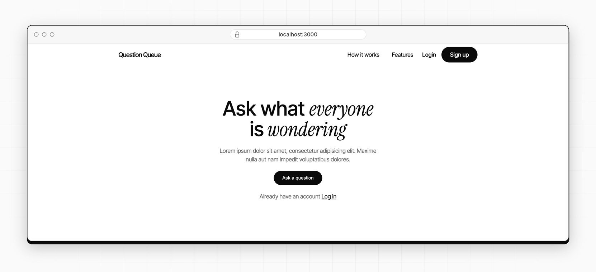

# Question Queue

A simple classroom question board built with Node.js, Express, EJS, Passport, and MongoDB. It lets students submit questions, upvote the ones they care about most, and helps instructors quickly see the most important topics to address during class.



## Features

- User signup and login with Passport authentication
- Submit questions with a topic, speaker name, and question text
- Sort the queue by popularity using vote counts
- Upvote existing questions without duplicating entries
- Mark questions as answered
- Remove questions when they are no longer relevant
- Clean landing page and queue experience built with EJS templates

## Tech Stack

- Node.js
- Express.js
- MongoDB + Mongoose
- EJS templating
- Passport.js for authentication
- dotenv for environment configuration

## Project Structure

```text
.
├── app/
│   └── models/
│       └── user.js
├── config/
│   └── passport.js
├── public/
│   ├── images/
│   ├── landing.css
│   ├── signup.css
│   ├── styles.css
│   └── main.js
├── views/
│   ├── landing.ejs
│   ├── login.ejs
│   ├── questionQueue.ejs
│   ├── signup.ejs
│   └── submitQuestion.ejs
├── .env.example
├── .gitignore
├── package.json
├── server.js
└── README.md
```

## Getting Started

### Prerequisites

- Node.js 18+
- MongoDB instance or MongoDB Atlas connection string

### Installation

```bash
npm install
```

### Environment Variables

Create a `.env` file in the project root with the following values:

```env
MONGODB_CONNECTIION=mongodb://localhost:27017/question-queue
SESSION_SECRET=your-session-secret
```

If you are using a different MongoDB connection string, replace the value accordingly.

### Run the app

```bash
node server.js
```

The app runs on port `8001` by default.

## Usage

1. Open the app in your browser.
2. Sign up for an account or log in.
3. Ask a question from the queue page.
4. Upvote questions that are important or commonly asked.
5. Mark questions as answered once they are covered in class.

## Notes

This project is a lightweight starter app for classroom engagement and can be extended with features like:

- admin moderation
- topic filtering
- user roles
- real-time updates with WebSockets
- analytics dashboard

## License

This project is licensed under the ISC license, as specified in the package configuration.
